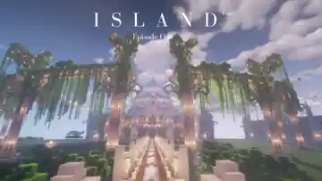

A S T R E A &nbsp; / &nbsp; A T R I U M

# O R I G O
### 一个世界，三种观看方式

**Minecraft Java 26.2** · **Fabric / Sodium / Iris** · **Visual Foundation v0.1.0**

*好奇即美德，求知即正义。*

[客户端手册](clients/README.md) · [主城原作](worlds/capital/README.md) · [开发路线](docs/ROADMAP.md) · [作者鸣谢](docs/CREDITS.md)

---

## 00. THE WORLD · 世界原点

© **[StarryYino](https://www.planetminecraft.com/member/starryyino/)** · [ISLAND Moonlight 原作与下载](https://www.planetminecraft.com/project/island-moonlight-fantasy-build-download/)。上图取自作者随地图压缩包提供的 **I S L A N D.png 原作封面**，本仓库存储了压缩后的本地预览副本（不再依赖外站图片热链）；**不是 ORIGO 已完工主城**。点击封面可前往原作页面。

**ORIGO** 是 ASTREA 世界观下的 Minecraft 世界。我们不把玩家限制在某一种图像表达中，而是为同一座世界提供三套不同的审美语言——**空灵、奥术、本源**。

**ATRIUM** 是承载 ORIGO 的系统基础设施。未来服务器将作为 ATRIUM **深圳首期单站点部署**中的 Minecraft 服务模块，接受统一的生命周期、权限、备份与远程管理。本仓库优先维护公开的 **客户端发行工程**，不承载服务器凭据、管理接口或私人世界数据。

> **项目状态**：三套视觉选型、版本锁定和构建流程已建立；目前仍是 **v0.1.0 预览配置**。尚未完成实机性能基准、联机兼容性和旧版主城地图迁移测试。所有硬件档位属于规划建议，不是实测帧率保证。

## 01. THREE VISIONS · 三种视界

<table>
  <tr>
    <th width="33%">I · ETHEREAL / 空灵</th>
    <th width="33%">II · ARCANE / 奥术</th>
    <th width="34%">III · ORIGIN / 本源</th>
  </tr>
  <tr>
    <td></td>
    <td></td>
    <td></td>
  </tr>
  <tr>
    <td>轻盈 · 柔和 · 童话式探索</td>
    <td>古典 · 细致 · 魔法幻想</td>
    <td>原版精修 · 写实光影 · 沉浸</td>
  </tr>
  <tr>
    <td>Dandelion X 26.2 / 16× Complementary Reimagined r5.9.3</td>
    <td>Alacrity Update #39 / 32× BSL Shaders 10.1.8</td>
    <td>Vanilla Experience+ v2.0 / 16× iterationT 3.2.0（须手动安装）</td>
  </tr>
  <tr>
    <td><a href="clients/ethereal.json">版本锁定清单 →</a></td>
    <td><a href="clients/arcane.json">版本锁定清单 →</a></td>
    <td><a href="clients/origin.json">版本锁定清单 →</a></td>
  </tr>
</table>

三张图来自 [Dandelion X 画廊](https://www.curseforge.com/minecraft/texture-packs/dandelion-x/gallery)、[Alacrity 官方画廊](https://modrinth.com/resourcepack/alacrity/gallery) 与 [Minecraft.fr 的 iterationT 展示](https://minecraft.fr/le-shader-survival-iterationt-une-atmosphere-unique-dans-minecraft/)。它们**只说明单项资源的美术效果**，不是上述两两组合的实机测评截图。原作权利归各作者。

### I / ETHEREAL — 空灵

*在晨雾、花野与温柔色彩里探索。*

Dandelion X 以干净、统一的色盘和友好的纹理设计为核心，适合日常生存、探索、花园与轻快建筑；Complementary **Reimagined** 通过更自然的光影增强层次，同时保留游戏的经典外观。视觉上它是三套之中较轻盈的一套，但**有光影就仍会占用 GPU**。

| 项目 | 配置 |
| --- | --- |
| 材质包 | [Dandelion X 26.2](https://modrinth.com/resourcepack/dandelion-x/version/nBLlBjME)，16× |
| 光影包 | [Complementary Reimagined r5.9.3](https://modrinth.com/shader/complementary-reimagined/version/Bqen1mJX)（不是 Unbound） |
| 体验侧重 | 柔和统一的景观、自然探索、轻量化画面 |
| **参考入门硬件** | 16 GB RAM、GTX 1650 / RX 580 级独显 |
| **舒适档位** | RTX 2060 / RTX 3060 或同级独显及以上 |
| JVM / 初始视距 | **4 GiB** / 8–12 chunks；光影从 Low / Medium 试起 |

### II / ARCANE — 奥术

*为浮空城、古堡和神秘的魔法图书馆而生。*

Alacrity 使用 32× 纹理，强化石材、木构、植被和部分立体模型的复杂性；BSL 在照明、阴影和空气感上构造温暖而带戏剧性的画面。这套配置最适合 **ORIGO 未来主城的奇幻古典建筑**。

| 项目 | 配置 |
| --- | --- |
| 材质包 | [Alacrity Update #39](https://modrinth.com/resourcepack/alacrity/version/39)，32× |
| 光影包 | [BSL Shaders 10.1.8](https://modrinth.com/shader/bsl-shaders/version/Y68yiql9) |
| 体验侧重 | RPG 奇幻、美术细节、室内光影、城堡景观 |
| **参考入门硬件** | 16 GB RAM、RTX 2060 / RX 6600 级独显 |
| **舒适档位** | RTX 3060 / RTX 4060、RX 6700 XT 或同级 |
| JVM / 初始视距 | **5–6 GiB** / 8–12 chunks；BSL 先用 Medium |

后续可能通过经测试的 EMF / ETF / Continuity 等优化一些 Alacrity 扩展效果；它们**当前还没有被加入发行包**。

### III / ORIGIN — 本源

*熟悉的原版，被新的光线重新书写。*

Vanilla Experience+ 对 Minecraft 经典外观进行克制的修整，而 **iterationT 3.2.0** 强化体积雾、云、阴影、反射和整体空间气氛。Origin 已正式决定采用 **Vanilla Experience+**，**不再使用 Faithful 32×**。

| 项目 | 配置 |
| --- | --- |
| 材质包 | [Vanilla Experience+ v2.0](https://modrinth.com/resourcepack/vanilla-exp/version/UBuTOpY1)，16× |
| 光影包 | [iterationT 3.2.0](https://www.minegraph.cn/shaderpacks/12)，**玩家手动下载和安装，不随发行包分发** |
| 体验侧重 | 高沉浸式原版、风景、写实光照、探索摄影 |
| **参考入门硬件** | 16 GB RAM、RTX 3060 / RX 6700 XT 级独显 |
| **舒适档位** | RTX 4070 / RX 7800 XT 或同级及以上 |
| JVM / 初始视距 | **6 GiB** / **10 chunks**；先降低体积云和阴影质量 |

iterationT 发布信息注明暂不支持 macOS / Apple Silicon；对 Minecraft 26.2 + Iris 的具体兼容性仍须在本项目中实测验证。手动安装是出于下载来源及分发边界，并非随意替换已选光影。

### 硬件选择速览

| 维度 | ETHEREAL | ARCANE | ORIGIN |
| --- | --- | --- | --- |
| 风格 | 色彩与构图 | 纹理细节 | 真实感光照 |
| 材质分辨率 | 16× | 32× | 16× |
| RAM 建议 | 16 GB | 16–32 GB | 16–32 GB |
| JVM 建议 | 4 GiB | 5–6 GiB | 6 GiB |
| GPU 规划起点 | GTX 1650 / RX 580 | RTX 2060 / RX 6600 | RTX 3060 / RX 6700 XT |
| 光影关闭后 | 可游玩 | 可游玩 | 可游玩，缺少主要视觉特征 |

这些型号是**1080p 规划起点**，不是针对某场景的实测最低规格，未保证具体 FPS；驱动、显卡显存、分辨率、视距、多人主城和光影预设都会影响结果。低配机器可关闭光影保留材质包体验。

## 02. CLIENT DELIVERY · 安装与发行

三套发行配置均使用 **Minecraft Java 26.2 + Fabric 0.19.5 + Sodium 0.9.2 + Iris 1.11.4**，目标是三套不同美术客户端进入 **同一个 ORIGO 服务器**。

仓库提供符合 Modrinth 规范的 **.mrpack 构建器**：锁定上游版本，向 Modrinth API 查询官方文件的下载地址、SHA1、SHA512 与文件大小，并生成供启动器安装的清单。仓库**不上传第三方材质、光影和 Mod 的二进制副本**。

~~~bash
# Python 3.10+；构建时需要联网访问 Modrinth API
python scripts/build_clients.py --all

# 不联网的本地测试
python -m unittest discover -s tests -v
~~~

成功后将生成：

- <code>dist/ORIGO-Ethereal-0.1.0.mrpack</code>
- <code>dist/ORIGO-Arcane-0.1.0.mrpack</code>
- <code>dist/ORIGO-Origin-0.1.0.mrpack</code>

也可前往 [GitHub Actions / Build ORIGO Clients](https://github.com/ZhenmingSun2003-rgb/Astrea-ATRIUM-ORIGO-MC/actions/workflows/build-clients.yml) 查看构建与下载 Artifacts（实际可下载取决于工作流运行结果）。导入到支持 Modrinth 整合包的启动器后，还需**在游戏内手动启用材质和光影**。

**Origin 额外安装**：根据 [iterationT 原始来源入口](https://www.minegraph.cn/shaderpacks/12) 获取 3.2.0 ZIP，放入实例的 <code>shaderpacks/</code>，不解压，再从 Iris 选择。导入包**没有**包含 iterationT。

完整操作与故障处理：[客户端使用手册 →](clients/README.md)。

## 03. CAPITAL / 主城基础工程

| 名称 | 项目定位 |
| --- | --- |
| **ISLAND Moonlight** | 未来主城建筑基础，规划为 ORIGO 玩家公共区域的核心 |
| **创作者** | [**StarryYino**](https://www.planetminecraft.com/member/starryyino/) |
| **原作与下载** | [Planet Minecraft 原始项目页](https://www.planetminecraft.com/project/island-moonlight-fantasy-build-download/) |
| **原版存档** | Minecraft Java Edition **1.16.4** |
| **未来目标** | 在独立测试存档升级、排障、规划传送与主城公共区，之后再考虑生产部署 |
| **当前状态** | **已保存出处、版权声明和迁移计划，原始地图 ZIP 未在本仓库重新分发** |

原作者允许正常游戏及非营利使用、禁止出售或营利性再分发，并要求视频等媒体展示署名；如果将来涉及收费、赞助或商业服务器使用，须重新核实许可。1.16.4 → 26.2 跨版本存档更新须在**备份后的测试副本**中完成，不能直接拿原件覆盖服务器。

[阅读 ISLAND Moonlight 主城档案 →](worlds/capital/README.md)

## 04. REPOSITORY / 仓库结构

~~~text
README.md                         中文发行手册与视觉总览
clients/
  ethereal.json                   空灵：上游版本锁定
  arcane.json                     奥术：上游版本锁定
  origin.json                     本源：上游版本锁定与手动光影说明
  README.md                       详细安装说明 / 排障 / 版本边界
worlds/capital/
  README.md                       原作者署名、地图使用范围与迁移清单
  source.json                     主城地图元信息
scripts/
  build_clients.py                标准 .mrpack 构建器
tests/
  test_build_clients.py           离线自动测试
docs/
  ROADMAP.md                      客户端优化 Mod 与版本迭代计划
  CREDITS.md                      第三方来源、作者与权利说明
.github/workflows/
  build-clients.yml               自动验证与构建产物
.gitignore
~~~

## 05. NEXT / 接下来

**v0.1 — Visual Foundation**：三种风格、固定依赖、构建流程和主城素材登记。  
**v0.2 — Comfort & Optimization**：逐步评审客户端性能 Mod、渲染扩展、HUD、地图、UI、无障碍与体验细节。  
**v0.3 — Benchmark**：三套客户端对同一地图做 FPS / 1% low / 内存 / GPU / 联机兼容测评。  
**v0.4 — Capital Integration**：主城地图迁移、结构修复、二次设计、源作者署名。  
**v1.0 — ORIGO Launch**：深圳 ATRIUM 下的 Minecraft 服务部署、备份与恢复、运行监控。

[阅读开发路线与 Mod 纳入准则 →](docs/ROADMAP.md)

---

**A S T R E A — A T R I U M / O R I G O**

Minecraft © Mojang / Microsoft；地图 © StarryYino；其他第三方资源及展示图片 © 各自权利人。本站不隶属于 Mojang 或相关原作者，亦不替他们授予再分发权。详见 <a href="docs/CREDITS.md">Credits</a>。

